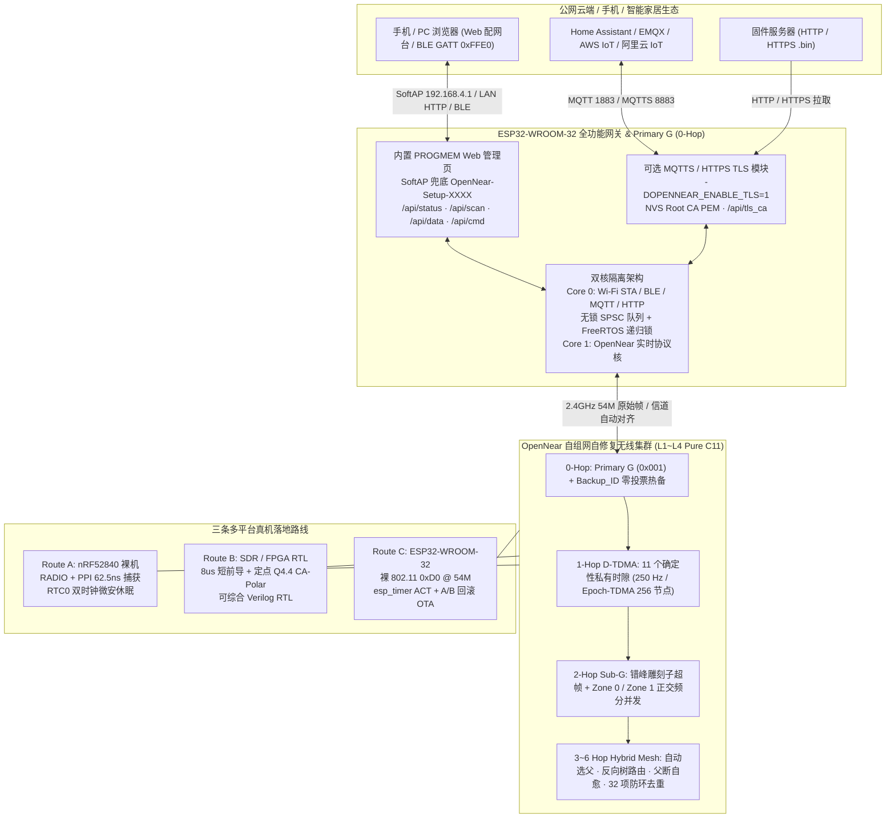
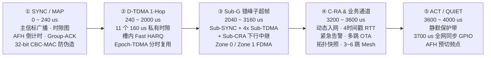
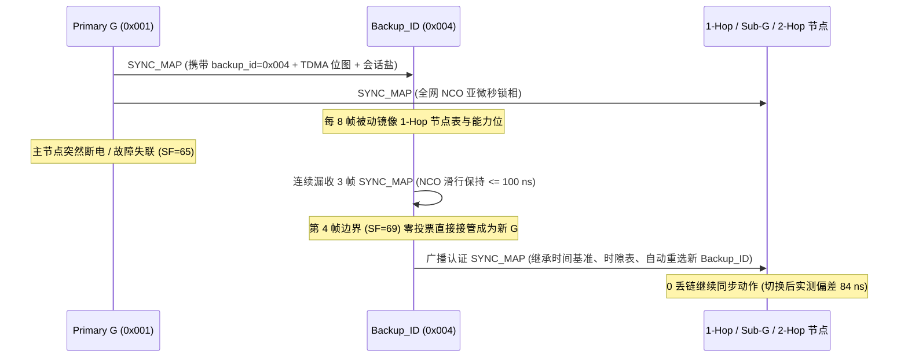

<div align="center">

# OpenNear

**零历史包袱、从零设计的开源类星闪（NearLink-Class）确定性无线协议栈与万物互联混合 Mesh 平台**

[](https://github.com/OnelongX/OpenNear/actions/workflows/ci.yml)


[](https://onelongx.github.io/OpenNear/)


**亚微秒全网同步 · 6 字节极简帧头 · 零投票热备秒切 · 无主冷启动 · 1~6 跳混合 Mesh · 256 节点 Epoch-TDMA · 多跳加密 OTA · 浏览器一键在线刷机 · 内置 SVG 拓扑配网页 · MQTTS/TLS & Home Assistant**

> ⚡ **零门槛 30 秒体验**：插上 15 块钱 ESP32-WROOM-32，直接用 Chrome / Edge 打开 **[OpenNear 在线刷机台](https://onelongx.github.io/OpenNear/)**（基于 ESP Web Tools + GitHub Pages 自动构建），无需安装任何编译器即可一键烧录网关与多板同步灯光/遥测演示节点！

</div>

---

## 一、为什么造 OpenNear？

传统物联网无线协议长期存在“两难割裂”：**Wi-Fi 吞吐高但延迟抖动大、功耗高、难以硬同步**；**BLE Mesh / Zigbee 功耗低但同步精度停留在毫秒级、洪泛风暴严重、难撑高实时控制**。

**OpenNear** 借鉴星闪（NearLink / SparkLink）核心思想，采用**纯 C11 零外部依赖协议核**从零构建，在同一套极简协议上打通 **L1 抗干扰物理层 → L2 四段式确定性超帧 → L3 亚微秒同步与多跳自愈 → L4 万物互联云边协同**，让几块钱一块的 **ESP32-WROOM-32** 或 **nRF52840** 就能组成高确定性、自组网、自修复、直连 Home Assistant 与公网云平台的无线集群。

| 能力维度 | OpenNear v6.9 | BLE Mesh | Wi-Fi Mesh | Zigbee / Thread |
|---|---|---|---|---|
| **同步精度（硬件定时 / 仿真）** | **亚微秒级（实测 90 ns 稳态）** | 10 ~ 100 ms | 1 ~ 20 ms | 1 ~ 10 ms |
| **MAC 帧头开销** | **6 字节**（含 `Hdr_CRC8`，隐式模式 2 字节） | 29+ 字节 | 24~36 字节 | 15~25 字节 |
| **主控宕机自愈** | **Backup_ID 零投票热备，第 4 帧无缝接管** | 依赖泛洪 | 秒级重路由 | 数秒重选 |
| **无主冷启动自组网** | **支持（零预设主控，自动竞选 + 脑裂裁决）** | 需 Provisioner | 需主路由 | 需协调器 |
| **多跳与大规模容量** | **1~2 跳确定性 Sub-G + 3~6 跳 Mesh + 256 节点 Epoch-TDMA** | 洪泛多跳 | 2~4 跳 | 树/网状多跳 |
| **安全与抗重放** | **AES-128-CCM + Beacon CBC-MAC + X25519 + 32 槽 LRU 防重放** | AES-CCM | WPA2/3 | AES-CCM |
| **空中固件升级（OTA）** | **多跳广播/中继 + 32 块滑动窗口 NACK + CBC-MAC 鉴权 + 同步切换** | 极慢 | 单点 HTTP | 慢 |
| **云端与生态接入** | **内置 SoftAP Web 配网页 + BLE GATT + HTTP API + MQTT/MQTTS + HA 自动发现** | 需网关 | 原生 IP | 需边界路由 |

---

## 二、系统架构图

### 1. 全栈协议与万物互联混合组网架构



### 2. 4 ms（250 Hz）四段式动态超帧与 Sub-G 错峰多跳时序



### 3. 主节点宕机零投票热备自愈（Backup_ID Failover）



---

## 三、核心特性一览

- **极简确定性内核（Pure C11，零第三方库依赖）**
  - **6 字节短 MAC 帧头**（12-bit Short-ID + 独立 `Hdr_CRC8` 拦截），支持 **2 字节隐式头** 与 **Super-Slot 聚合**、**500 us / 1 ms / 4 ms 多档超帧**。
  - **亚微秒同步三步链**：硬件 RX 时间戳捕获 + 4 时间戳 RTT 往返校准 + 二阶 Alpha-Beta-Gamma 温漂加速度 NCO TC-PLL；针对 ESP32 排队 Wi-Fi 额外配备 **非对称最小延迟包络滤波器**（在 1800 us 队列毛刺下仍稳在 **323 ns**）。
- **抗干扰与通感一体（对标星闪 2.0）**
  - **L1 控制面 CA-Polar (N=128, K=40~96, CA-SCL L=8)**：支持浮点、**Q4.4 定点归一化 Min-Sum** 与 **2-TX Chase 软合并 HARQ**；附带可综合 Verilog RTL。
  - **TSCH 自适应跳频（AFH）**：实时黑名单 Wi-Fi 干扰信道 + BLE Instant 风格原子倒计时全网同步切频 + 冷启动扫频入网。
  - **ISAC 厘米级测距**：16 频点多载波相位差（MCPD）+ ToF 双重校验与防中继攻击地理围栏（实测误差 **0.23 cm**）。
- **真正自组网、自修复、万物互联**
  - **无主冷启动自动竞选（Leaderless Boot）**：任意节点上电侦听超时后按 MAC 退避自动推举 Primary G，内置低 `session_salt` 脑裂自动收敛。
  - **全网任意节点可查拓扑与实时数据**：无论直连 G、1 跳终端还是 2 跳穿墙节点，都可通过串口/BLE `TOPO?`/`DATA?` 或 HTTP `/api/topology` & `/api/data` 拉取完整集群状态与实时载荷。
  - **多跳认证节点 OTA**：AES-128-CCM 传输加密 + 流式 Flash **AES-128-CBC-MAC & CRC32** 双重鉴权 + 32 块滑动窗口选择性 NACK + 全员同步切换 + ESP32 A/B 分区延迟启动确认防变砖回滚。
  - **内置零配置 Web 配网管理台（v6.3）**：存放于 Flash `PROGMEM`（0 字节静态 RAM），无 Wi-Fi 凭据或 20 秒连不上路由器时自动开启 `OpenNear-Setup-XXXX` 热点（`http://192.168.4.1`），支持扫描 Wi-Fi、配置 MQTT/MQTTS、实时监控全网节点、远程控节点、下发 OTA、管理 Admin Token。
  - **可选 MQTTS / HTTPS TLS 加密上云模块（v6.4）**：通过 `-DOPENNEAR_ENABLE_TLS=1` 按需编译，默认零内存开销；开启后支持 MQTTS 8883、HTTPS Webhook/OTA 及 NVS Root CA PEM 证书验签，无缝对接 Home Assistant、EMQX Cloud、AWS IoT、阿里云 IoT。
  - **全网永久硬件 MAC48 透传与实体锚定（v6.5 ~ v6.6）**：自动读取 ESP32 出厂 eFuse Wi-Fi STA MAC（及网关 BLE MAC `ESP_MAC_BT`）/ nRF52840 FICR 地址，经 0~6 跳全链路（Sub-G 私有 D-TDMA `MAC_REPORT` + 3~6 跳 `ON_MESH_TOPO_REPORT` + 3-bit 跳深无截断 `TOPO_RESP`）透传至拓扑表、HTTP/串口/BLE、Web 页与 Home Assistant（`uniq_id: opennear_<MACHEX>`、`cns: [["mac", "..."]]`），配套 2~6 跳幽灵节点自动超时老化清理。
  - **真机工程化与多网关生产级特性（v6.6 ~ v6.8）**：SoftAP 自动弹出配网页（Captive Portal DNS）+ 按 MAC 唯一 mDNS（`opennear-XXXX.local`）与唯一 MQTT ClientID（多网关同 Broker 零互踢）；MQTT 非阻塞 `CONNACK` 鉴权 + LWT 遗嘱在线状态 + **全链路 MAC 主题寻址**（`opennear/node/<MAC>/state` & `opennear/cmd/<MAC>`，主备热切自动零碰撞回填全网 MAC）；按 MAC 永久别名与内置零依赖 **SVG 多跳拓扑图**；集群独立空口密钥 `NETKEY:<32hex>` + 板载 `BOOT` 键（GPIO0）长按 5 秒硬件恢复出厂配网。
  - **浏览器一键刷机与同步演示套件（v6.9）**：新增 [docs/index.html](./docs/index.html)（ESP Web Tools 零安装在线刷机台，GitHub Pages 自动编译打包 4 套合并固件）与开箱即用同步演示固件 `esp32_demo_sync_node`（支持全网同拍 `SYNC / STROBE / PULSE` 灯效、GPIO26 继电器、GPIO34 实时 ADC 遥测，Web 管理页一键触发）。

---

## 四、自动化验证与实测基准成绩单

所有核心指标均由本地一键脚本 [`build_and_test.ps1`](./build_and_test.ps1) 与 GitHub Actions CI 自动回归验证：

| 验证项 | 实测指标 | 结论 |
|---|---|---|
| **核心协议单测与集成套件**（`tests/test_opennear.c`） | **38 套测试 / 391 项断言全部通过**（`0 failed`，`-Wall -Wextra -Wshadow -Wformat=2 -Wundef` 0 告警） | PASS |
| **10 节点多跳全生命周期仿真**（含 2 堵墙 2-Hop） | 稳态最大偏差 **90 ns** · 10 帧断联保持 **100 ns** · 主节点宕机热切后 **84 ns** · **0 碰撞** | PASS |
| **ESP32 队列毛刺抗抖动验证**（`[TEST 25]`） | 1800 us Wi-Fi TX 排队毛刺下时钟相位误差 **323 ns**（Lookahead ACT 误差 **343 ns**） | PASS |
| **L1 8 us 短前导捕获**（+40 ppm CFO + 2-Tap 瑞利多径） | `-3 dB` 命中 **88.0%** · `0 dB` 命中 **99.0%**（定时误差 **33.8 ns**）· `+6 dB` **100.0%（0 ns）** | PASS |
| **L1 CA-Polar (N=128, K=48) BLER** | `Es/N0 = -3 dB`：Q4.4 定点 **98.5%** · 2-TX 软合并 HARQ **100.0% (200/200)** | PASS |
| **星闪 2.0 ISAC 测距与防中继**（`[TEST 18]`） | 真实 `1.650 m` → MCPD `1.648 m`（误差 **0.23 cm**）；中继放大攻击 100% 拦截 | PASS |
| **256 节点 Epoch-TDMA 占空比**（`[TEST 30/32]`） | 8 共享时隙 × 32 周期 = **256 节点 0 碰撞**，32 周期休眠射频占空比 **0.31%** | PASS |
| **跨平台真机交叉编译 + Python 测试** | nRF52840 裸机 **PASS** · ESP32 明文 & TLS (`-Werror`) **21/21 PASS** · Python 日志/同步测试 **6/6 PASS** | PASS |

---

## 五、ESP32 组网规模指南

| 组网模式 | 可支持 ESP32 数量 | 关键配置 | 适用场景 |
|---|---|---|---|
| **开箱即用（纯 1 跳直连）** | **12 台**（1 G + 11 从机） | 默认 `ON_DEFAULT_MAX_SLOTS = 11` | 4 ms（250 Hz）高频同步控制 |
| **开箱即用（1 跳 + Sub-G 两跳）** | **16 ~ 20 台** | 单 Sub-G 挂 4 台；双 Zone Sub-G 挂 8 台 | 跨墙多房间组网、Web 拓扑页全量展示 |
| **开启 3~6 跳 Hybrid Mesh** | **约 32 台**（默认表长） | `ON_MESH_MAX_ROUTES = 32` / `ON_SEC_REPLAY_SLOTS = 32` | 跨楼层/长走廊接力（>24 台调大 `ON_MAX_CLUSTER_NODES`） |
| **Epoch-TDMA 分时复用** | **调度上限 256 台**（ESP32 实测建议 **50~100 台**） | 放大节点表宏 + `on_node_set_epoch_schedule(..., 16/32)` | 低频传感器（1~10 Hz）+ 少量高频执行器混合 |
| **超百台大规模部署** | **无上限（多集群水平扩展）** | 每 15~30 台为一个 OpenNear 集群，统一经 MQTT/MQTTS 接入同一 Broker / HA | 工厂、楼宇、农业大棚多区协同 |

---

## 六、目录结构

```text
opennear/
├── build_and_test.ps1                 # 一键构建：38 组单测 + 10 节点仿真 + L1 基准 + ESP32(明文/BLE/TLS)/nRF52 交叉编译
├── core/                              # 零外部依赖的纯 C11 可移植协议核（Host / ESP32 / nRF52 共用）
│   ├── include/
│   │   ├── on_types.h                 # 12-bit Short-ID、四段式超帧时隙常量与角色定义
│   │   ├── on_frame.h                 # 6 字节极简 MAC 帧头 + Hdr_CRC8 + 载荷 CRC16 编解码
│   │   ├── on_polar.h                 # L1 控制面短码 CA-Polar (N=128, K=40..96, 浮点/Q4.4 定点/软合并 HARQ)
│   │   ├── on_sync.h                  # L3 亚微秒同步链：硬捕获 + 4时间戳 RTT + 二阶 ABG TC-PLL + 排队包络滤波
│   │   ├── on_superframe.h            # L2 四段式超帧排班 + 500us/1ms/4ms 多档 + Super-Slot 聚合
│   │   ├── on_sec.h                   # 安全层：AES-128-CCM + Beacon CBC-MAC + Session Salt + 32 槽 LRU 防重放
│   │   ├── on_ecdh.h                  # 零预置密钥配网：恒定时间 X25519 (RFC 7748) + OOB PIN 密钥派生
│   │   ├── on_afh.h                   # TSCH 自适应跳频 + Wi-Fi 干扰黑名单 + 原子倒计时 + 冷启动扫频
│   │   ├── on_amc.h                   # L1 双波形速率自适应调制编码（2M MSK <-> 4M QPSK <-> 20M OFDM）
│   │   ├── on_sar.h                   # 轻量分片重组（最高 1 KB）+ 3 级抢占式 QoS 队列
│   │   ├── on_ranging.h               # 星闪 2.0 通感一体：16 频点 MCPD + ToF 厘米级测距与防中继围栏
│   │   ├── on_ota.h                   # 多跳节点 OTA：流式 Flash CBC-MAC + CRC32 + 32 块 NACK + 同步激活
│   │   ├── on_gateway.h               # 公网 Wi-Fi/BLE/MQTTS 共存网关 + 无锁 SPSC 队列 + Admin Token 鉴权
│   │   ├── on_mesh.h                  # 3~6 跳混合 Mesh 路由自愈 + 256 节点多周期 Epoch-TDMA 休眠调度器
│   │   ├── on_mqtt.h                  # 纯 C11 OASIS MQTT 3.1.1 编解码器 + TCP 流式拆包 + HA 自动发现
│   │   └── on_node.h                  # 完整节点引擎（无主冷启动 / G / T / Sub-G / 独立 ACT 时钟 / 拓扑快照）
│   └── src/
├── hal/
│   └── on_hal.h                       # 跨平台射频 / 高精定时器 / GPIO 硬件抽象层
├── sim/                               # 10 节点多跳物理仿真器（CLI 混沌参数注入 + CSV + PCAP + 仪表盘数据）
├── tests/
│   ├── test_opennear.c                # 38 组全链路自动化单测与集成断言套件（391 项断言）
│   ├── test_esp32_failover_hw.py      # ESP32 双板主备 RTS 复位长稳回归测试脚本
│   ├── measure_esp32_gpio_sync.py     # ESP32 MCPWM 双板 GPIO 同步误差测量脚本
│   ├── capture_esp32_act_trace.py     # ESP32 双板 ACT 全链路追踪抓取脚本
│   ├── analyze_esp32_act_trace.py     # ESP32 双板 ACT 误差逐段拆解分析脚本
│   ├── test_analyze_esp32_hw_log.py   # 真机串口日志诊断工具自动化单元测试
│   └── test_measure_esp32_gpio_sync.py
├── tools/
│   ├── dashboard.html                 # HTML5 协议可视化与极限破坏性混沌压测工作台
│   ├── chaos_server.mjs               # 驱动底层 C11 仿真引擎的交互式本地压测服务器
│   ├── analyze_esp32_hw_log.py        # ESP32 真机串口日志自动化诊断工具（离线目录 / 实时 COM 口）
│   └── opennear_dissector.lua         # Wireshark Lua 抓包解析插件（DLT_USER0 = 147，支持 0x0~0xD 全帧型）
└── ports/
    ├── esp32_wroom32/                 # 路线 C：ESP32-WROOM-32 裸 0xD0 @ 54M + 内置 Web 配网页 + 可选 TLS
    │   ├── include/
    │   │   ├── esp32_web_portal.h     # 内置 PROGMEM 离线 Web 配网与集群管理页（0 字节静态 RAM）
    │   │   ├── esp32_tls_transport.h  # 可选 MQTTS / HTTPS TLS 传输模块（-DOPENNEAR_ENABLE_TLS=1）
    │   │   ├── esp32_net_gateway.h    # Wi-Fi STA + SoftAP + BLE GATT + MQTT + HTTP API 桥接
    │   │   ├── esp32_ota_flash.h      # ESP32 A/B 双分区 OTA 读写与延迟确认防变砖回滚
    │   │   ├── hal_esp32_raw80211.h   # 裸 802.11 Action 0xD0 射频与 esp_timer 驱动
    │   │   └── act_capture.h          # MCPWM 双通道硬件 GPIO 边沿捕获
    │   ├── src/
    │   └── platformio.ini             # 11 个开箱即用环境（含 esp32_iot_mesh_gw / esp32_iot_mesh_gw_tls 等）
    ├── nrf52840_bare/                 # 路线 A：nRF52840 裸 RADIO+PPI + RTC0 双时钟微安休眠 + 启动/链接脚本
    └── sdr_fpga_ref/                  # 路线 B：CFO(+40ppm)+多径短前导 + 定点 Q4.4 CA-Polar + 可综合 Verilog RTL
        └── rtl/                       # opennear_preamble_correlator.v + opennear_polar_encoder/decoder_n128.v + tb
```

---

## 七、5 分钟极速上手

### 1. Windows 一键编译与全量验证

```powershell
powershell -ExecutionPolicy Bypass -File .\build_and_test.ps1
```

可选启动本地交互式混沌压测仪表盘（浏览器访问 `http://127.0.0.1:38080`）：

```powershell
node .\tools\chaos_server.mjs
```

### 2. 路线 C：ESP32-WROOM-32 烧录与零配置配网

进入 `ports/esp32_wroom32/`，使用 PlatformIO 选择适合你的固件环境：

```powershell
# ① 万物互联全功能网关（推荐，局域网轻量明文版：Web 配网页 + BLE + MQTT/HA + OTA + 无主自愈）
pio run -d .\ports\esp32_wroom32 -e esp32_iot_mesh_gw -t upload

# ② 可选 MQTTS / HTTPS TLS 加密上云版（开启 -DOPENNEAR_ENABLE_TLS=1，支持 8883 加密、HTTPS OTA 与 Root CA 验签）
pio run -d .\ports\esp32_wroom32 -e esp32_iot_mesh_gw_tls -t upload

# ③ 从机终端（支持 OTA / BLE / 无主冷启动 / 自动做 Backup_ID 或 Sub-G 中继）
pio run -d .\ports\esp32_wroom32 -e esp32_node_t_ota -t upload

# ④ 极简纯协议同步演示（无 Wi-Fi/BLE 网关开销；任一从机 GPIO4 接地即可自动作为 Primary G 启动）
pio run -d .\ports\esp32_wroom32 -e esp32_node_g -t upload
pio run -d .\ports\esp32_wroom32 -e esp32_node_t -t upload
```

#### 零配置内置 Web 配网与集群管理台

1. 网关首次上电（或 20 秒连不上已保存路由器）自动开启兜底热点 **`OpenNear-Setup-XXXX`**。
2. 手机或电脑连上该热点，打开浏览器访问 **`http://192.168.4.1`**。
3. 在 **Wi-Fi / 云端配网** 页点击「扫描周边 Wi-Fi」，选中路由器输入密码保存——连网成功后 5 秒自动关闭兜底热点，同一管理台继续在局域网 IP（`http://<ESP32_IP>/`）长期在线。
4. 面板内置 4 大标签页：
   - **集群拓扑与实时数据**：实时查看全网 0~6 跳节点、同步偏差、OTA 状态与载荷 Hex/ASCII 解码；
   - **Wi-Fi / 云端配网**：周边 2.4 GHz 热点扫描、SSID/密码与 HTTP/HTTPS Webhook 配置；
   - **MQTT / MQTTS (TLS) & Home Assistant**：配置 Broker（1883 明文或勾选 8883 MQTTS）与上传 Root CA PEM 证书（`POST /api/tls_ca`）；
   - **节点控制 / 集群 OTA / 安全令牌**：任意 1~6 跳节点下行控制、多跳固件升级与 `Admin Token` 设置/轮换。

#### BLE GATT（`0xFFE0`）& HTTP API & 串口指令速查

- **HTTP 接口**：`GET /`（管理页）、`GET /api/status`、`GET /api/scan`、`GET /api/topology`、`GET /api/data`、`POST /api/cmd`、`POST /api/tls_ca`
- **BLE 写通道（`0xFFE2`）与 `POST /api/cmd` 支持文本指令**：
  - `WIFI:<ssid>|<pass>[|<cloud_url>]`
  - `MQTT:<host>|<port>[|<user>|<pass>[|<tls:0|1>]]` 或 `MQTTS:<host>|<port>[|<user>|<pass>]`
  - `TOKEN:<new_token>`（设置/轮换/清空 Admin Token；启用后写操作须带 `AUTH:<token>|...` 或 HTTP 头 `X-OpenNear-Token`）
  - `OTA:<target_hex>|<ver>|<http_or_https_url>`（`FFF` 为全网广播）
  - `CMD:<target_hex>|<payload>`（1~6 跳自动选路下发）
  - `TOPO?` / `DATA?`（串口 `115200` 与蓝牙均支持，在任意节点查询全网拓扑与实时数据）

---

## 八、ESP32 真机实测、回归与高精度诊断指南

> **ESP32 射频实现说明**：节点使用 `GPIO2` 输出超帧 ACT 动作，串口 `115200` 输出 1 Hz 状态。ESP32 原始 Wi-Fi 发送由驱动排队，提交成功不代表已离开发射天线，因此该端口不启用空口 RTT 校准或基于提交时间的 PTP 跟进修正；备用节点须同时满足连续漏收至少 **12 帧** 且本地计时至少 **150 ms** 未收有效同步帧才接管（仿真与其他硬件端口默认 3 帧）。主节点重启更换会话或时隙租约回收（ESP32 上行租约默认 250 SF ≈ 1 s）后，直连从节点会自动无重启重新入网并恢复备用资格；同会话密钥轮换不触发重入网。

### 1. 双板主备真机回归

烧录主控和备用节点后，关闭占用两个串口的监视器，在项目根目录运行：

```powershell
python -m pip install pyserial
python .\tests\test_esp32_failover_hw.py --primary COM3 --backup COM4
```

将端口号替换成实际值。脚本通过 RTS 多次复位主控（要求主控板 USB 串口支持 RTS 拉住 EN），不擦除 Flash。默认先观察 180 秒，再执行 12 轮主备切换，最后观察 30 秒，验证备用接管、原主恢复后备用无需重启自动重新入网并重获备用资格。日志与 JSON 摘要输出到 `build/hardware-esp32/`。

### 2. 真机串口日志自动化诊断（离线 / 实时 COM 口）

对单板/多板串口日志（或直接监听 ESP32 串口）一键生成 **0~100 健康评分、TX 丢包率、NCO 晶振漂移统计、主备切换/重连/崩溃根因与事件时间线**：

```powershell
# 离线分析单个日志或整个目录，并导出 Markdown + JSON 报告
py .\tools\analyze_esp32_hw_log.py .\build\hardware-esp32\ --md hw_report.md --json hw_report.json

# 直接监听真实 ESP32 串口 60 秒，保存原始日志并立即诊断
py .\tools\analyze_esp32_hw_log.py --port COM3 --duration 60 --save esp32_run.log --md hw_report.md
```

### 3. 双板 GPIO 同步测量（无外置逻辑分析仪）

主控 ESP32 通过两个 MCPWM 捕获通道，用同一个硬件计数器给两路 GPIO 边沿打时间戳。拔掉两板 USB 电源后按 GPIO 编号接线：

| 信号 | 接法 |
|---|---|
| 共地 | 主控 `GND` ↔ 从机 `GND` |
| 主控 ACT | 主控 `GPIO2` → 主控 `GPIO32` |
| 从机 ACT | 从机 `GPIO2` → 主控 `GPIO33` |

不要把两块板的 `GPIO2` 并在一起，也不要互连 `3V3` 或 `5V`。两板接回原 USB 口后，仅主控烧录测量环境，运行：

```powershell
pio run -d .\ports\esp32_wroom32 -e esp32_node_g_capture -t upload --upload-port COM3
python .\tests\measure_esp32_gpio_sync.py --port COM3 --seconds 60
```

脚本默认在 ±10 ms 内一对一配对同极性边沿，`build/gpio-sync/` 保存原始串口记录、配对 CSV 和 JSON（正值表示从机在后）。如需估计通道间固有偏差，可先用同一主控 `GPIO2` 同时驱动 `GPIO32` 与 `GPIO33` 标定。

如需逐段拆解偏差来源，保持上述接线，烧录 `esp32_node_g_trace`（主控）和 `esp32_node_t_trace`（从机），运行：

```powershell
python .\tests\capture_esp32_act_trace.py --primary COM3 --terminal COM4 --seconds 60
python .\tests\analyze_esp32_act_trace.py <主板日志路径> <从板日志路径>
```

### 4. 可选实验：提前广播 GPIO 翻转（Lookahead）与独立 GPIO 动作时钟

- **提前广播 GPIO 翻转**：主板烧录 `esp32_node_g_lookahead`，从板烧录 `esp32_node_t_lookahead`。主板在翻转前 1–7 个超帧重复广播倒计时，从板取最早预测截止时间执行，目标帧信标迟到或丢失时也可准时翻转（仅用于直连二值 GPIO 演示，不修改 TDMA 时钟）。
- **独立 GPIO 动作时钟**：主板保留 `esp32_node_g_lookahead`，从板换烧 `esp32_node_t_act_clock`。从板保留最近 8 个 160 ms 时间块的低延迟样本并估计有界晶振频偏，通过 `OPENNEAR_ACT_CLOCK_BIAS_US=750` 补偿低延迟观测下限（换板子/信道/负载时应重新标定并用独立一轮 GPIO 捕获验证）。

---

## 九、路线 A（nRF52840 裸机）与路线 B（SDR / FPGA RTL）

### 路线 A：Nordic nRF52840 裸射频 + PPI（量产微安级低功耗）

进入 `ports/nrf52840_bare/`，使用 ARM GCC 工具链编译：

```bash
make -C ports/nrf52840_bare MASTER=1   # Primary G
make -C ports/nrf52840_bare MASTER=0   # Terminal / Sub-G / Backup
```

- 硬件 PPI 通道直连：`RADIO->EVENTS_ADDRESS -> TIMER0->TASKS_CAPTURE[0]`（**62.5 ns** 分辨率硬件捕获）与 `TIMER0->EVENTS_COMPARE[2] -> GPIOTE->TASKS_OUT[0]`（零 CPU 抖动硬件动作触发），搭配 `RTC0` 32.768 kHz 双时钟深度休眠。

### 路线 B：SDR / FPGA RTL 参考实现

`ports/sdr_fpga_ref/` 提供 `8 us` 短前导相关峰捕获器、定点 Q4.4 CA-Polar 编解码器与可综合 Verilog RTL（`opennear_preamble_correlator.v`、`opennear_polar_encoder_n128.v`、`opennear_polar_decoder_n128.v` 及回环测试平台 `tb_opennear_phy_loopback.v`），并与 C11 测试套件 `[TEST 16]` 逐比特对齐。

---

## 十、开源参考与许可证

- 按 L1 物理层、L2/L3 确定性同步与多跳、三条真机落地路线及原生星闪 SDK 整理的开源参考清单见：[REFERENCES.md](./REFERENCES.md)
- 本项目基于 [MIT License](./LICENSE) 开源，欢迎 Star、Fork、提 Issue 与提交真机实测报告！
